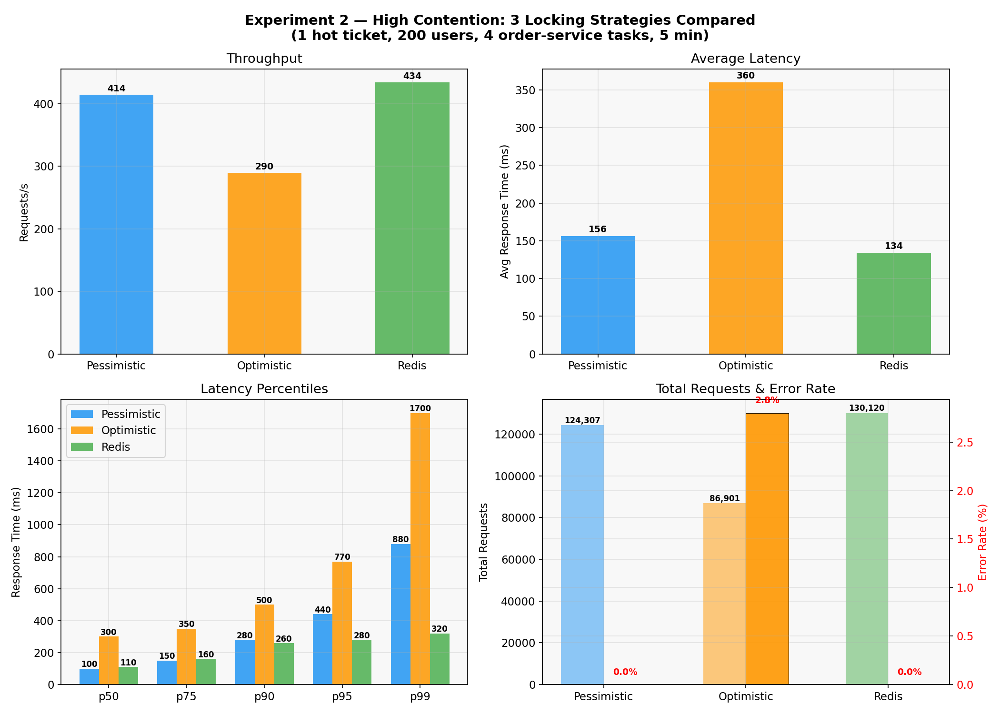
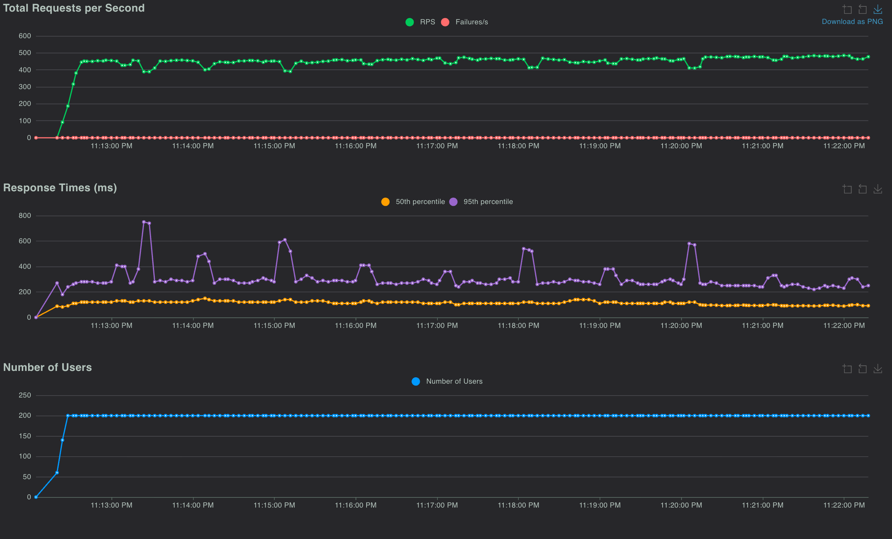

# Distributed Sports Ticket Reservation System

When tickets for a big game go on sale, thousands of people click "buy" at the same moment for a limited number of seats. If the backend isn't careful, two people can end up with the same seat, or a buyer whose connection hiccups gets charged twice. We built a ticketing backend on AWS that handles this, then load-tested three common ways of keeping purchases from colliding to see which one actually holds up when everyone wants the same seats.

The system handled around 500 requests a second (almost all of them ticket orders) without a single error, and it never sold a seat that wasn't available, in any test we ran. We also shut down a running server in the middle of a sale and no customer request failed. The best approach to coordinating buyers made the slowest purchases more than twice as fast as the textbook option, and a cache in front of the database cut the slowest page loads roughly in half.

Team project for CS 6650 (Scalable Distributed Systems) at Northeastern, by Nithish Bhat, Jingjing Pan, Hong Guo and Stella Zhang. The full write-up is in [`Project report.pdf`](Project%20report.pdf).

Stack: Go, PostgreSQL 15 (RDS), Redis 7.1 (ElastiCache), ECS Fargate, ALB, Terraform, Locust.

## How it works

```
                         Internet
                            │
                 ┌──────────┴──────────┐
                 │  Application Load   │
                 │  Balancer (port 80) │
                 └─────┬──────────┬────┘
     /tickets, /validate│          │/orders
              ┌─────────┴───┐  ┌───┴──────────┐
              │   ticket-   │  │    order-    │
              │   service   │  │    service   │
              │ (Go, :8080) │  │ (Go, :8081)  │
              │  read path  │  │  write path  │
              └──┬───────┬──┘  └──┬────────┬──┘
                 │       │        │        │
      read cache │       └───┬────┘        │ distributed lock
                 │           │             │
          ┌──────┴───────────┼─────────────┴──┐
          │  Redis 7.1 (ElastiCache)          │
          └───────────────────────────────────┘
                             │
                ┌────────────┴────────────┐
                │  PostgreSQL 15 (RDS)    │
                │  tickets · orders       │
                │  CHECK no_oversell      │
                └─────────────────────────┘

        All services run as ECS Fargate tasks in private subnets
```

We split reads and writes into two Go services so browse traffic doesn't compete with the order path and each side can scale on its own. `ticket-service` (default 2 tasks) serves ticket listings and the `/validate` oversell check, with an optional Redis read-aside cache. `order-service` (1-8 tasks) places orders. Both run on Fargate at 0.25 vCPU / 512 MB. Postgres (`db.t3.micro`) is the source of truth; we picked it over DynamoDB because the experiments need real multi-statement transactions and row locks. Redis (`cache.t3.micro`) holds the distributed lock and the read cache.

### Lock strategies

The order-service picks a strategy at deploy time from `LOCK_STRATEGY` (Terraform var `lock_strategy`):

- **Pessimistic:** `SELECT ... FOR UPDATE` on the ticket row inside a transaction, check capacity, update, insert the order, commit. Competing requests queue on the row lock.
- **Optimistic:** a single conditional update, `UPDATE tickets SET tickets_reserved = tickets_reserved + $qty WHERE id = $1 AND tickets_reserved + $qty <= quantity`. If no row changed, someone else got there first, so it retries up to 3 times with 50/100/200 ms backoff plus jitter.
- **Redis lock:** `SET NX` on `lock:ticket:{id}` with a 3 s TTL so a crashed holder can't block everyone. The value is a UUID and release goes through a Lua script that only deletes the key if it still holds that UUID. Up to 10 attempts with a 10-30 ms jittered spin.

### Correctness

The locking is backed by guarantees in the database, so a bug in any strategy still can't oversell:

- `CONSTRAINT no_oversell CHECK (tickets_reserved <= quantity)` on the tickets table. A violation (`23514`) comes back as `409 Sold out`.
- Every order carries an `idempotency_key` with a `UNIQUE` constraint. A repeated key returns the original order; concurrent duplicates (`23505`) are caught and re-queried.
- Postgres `lock_timeout=5s` and `statement_timeout=10s`, plus the Redis lock TTL, so nothing waits forever.
- `GET /validate` returns any ticket where `tickets_reserved > quantity`. Locust polls it throughout every run.

Schema is in [`sql/init.sql`](sql/init.sql).

### API

| Method | Path | Service | Description |
|---|---|---|---|
| `GET` | `/tickets` | ticket | List tickets (cached when enabled) |
| `GET` | `/tickets/{id}` | ticket | One ticket (cached when enabled) |
| `GET` | `/validate` | ticket | `200 {"valid": true}`, or `409` with the oversold tickets |
| `POST` | `/orders` | order | Reserve tickets |
| `GET` | `/health` | both | ALB health check |

`POST /orders` takes `{"ticket_id": 1, "quantity": 2, "idempotency_key": "order-abc-123"}` and returns `201` for a new order, `200` with the original order for a repeated key, `409` when sold out, and `400` for bad input. Ticket-service responses include an `X-Cache: HIT | MISS` header.

## Results

All runs used 200 Locust users at spawn rate 20 against the ALB. Raw output, CSVs and charts are in [`screenshots/`](screenshots/).

### 1. Horizontal scaling

5 min per run, pessimistic locking, traffic spread across the 4 tickets.

| order-service tasks | Req/s | Avg (ms) | p50 (ms) | p99 (ms) | Errors |
|---:|---:|---:|---:|---:|---:|
| 1 | 365 | 238 | 200 | 930 | 0% |
| 2 | 363 | 241 | 94 | 860 | 0% |
| 4 | 512 | 84 | 76 | 320 | 0% |
| 8 | 517 | 80 | 76 | 160 | 0% |

The big jump is 2 to 4 tasks. Going to 8 barely changes throughput but halves p99. By then the single `db.t3.micro` is the bottleneck, not the app tier, so about 4 tasks is the sweet spot for this load.

### 2. Lock strategies

High contention: one hot ticket, all 200 users on it, 4 order-service tasks, 5 min.

| Strategy | Req/s | Avg (ms) | p50 (ms) | p99 (ms) | Errors |
|---|---:|---:|---:|---:|---:|
| Pessimistic | 435 | 152 | 100 | 860 | 0% |
| Optimistic | 304 | 347 | 300 | 1,600 | 2.67% |
| Redis lock | 434 | 134 | 110 | 320 | 0% |



Low contention, spreading the same load over more tickets:

| Scenario | Pessimistic | Optimistic |
|---|---|---|
| 4 tickets (~50 writers per row) | 479 req/s, 92 ms avg | 409 req/s, 163 ms avg |
| 50 tickets (~4 writers per row) | 489 req/s, 84 ms avg | 491 req/s, 82 ms avg |

What we took from this: how much contention there is matters more than which strategy you pick. At around 4 writers per row they all perform the same. Optimistic locking falls apart under heavy contention because each failed attempt sleeps 50-200 ms, so retries stack up and some requests run out of them. Pessimistic matches Redis on throughput and is the simplest safe default, but requests queue on the row lock and it shows in p99. The Redis lock had the best tail latency because it moves the queue out of Postgres, at the cost of another dependency.

### 3. Failure recovery

10 min, 4 tasks, pessimistic locking. We killed one order-service task with `aws ecs stop-task` at about 5 min.

| Total requests | Req/s | Avg (ms) | p99 (ms) | Errors |
|---:|---:|---:|---:|---:|
| 270,876 | 451 | 139 | 450 | 0% |

The ALB deregistered the dead task, the other 3 took the load, and ECS started a replacement. Latency spiked briefly and settled within about 30 s. `/validate` confirmed no overselling afterwards.



### 4. Read cache

Read-heavy mix, 2 min, Redis read-aside cache (10 s TTL) toggled with `enable_cache`. Orders and `/validate` always go straight to Postgres.

| | Req/s | Avg (ms) | p50 (ms) | p99 (ms) | Max (ms) | Errors |
|---|---:|---:|---:|---:|---:|---:|
| No cache | 736.7 | 86.2 | 80 | 180 | 2,033 | 0% |
| Cache | 750.3 | 80.8 | 80 | 95 | 592 | 0% |

The median didn't move since Redis and Postgres are both about an 80 ms round trip from Locust for small payloads. The win is in the tail: p99 dropped 47% and max 71%. Even the uncached endpoints got better tails because the database was under less pressure. Overall throughput stayed bound by the write path.

## Running it

You need AWS credentials, Terraform 1.5+, Docker, and Python 3.10+ with `pip install locust`.

```bash
export DB_PASSWORD='choose-a-strong-password'
bash deploy.sh
```

`deploy.sh` provisions the VPC, RDS, ElastiCache, ECR, ECS and ALB in `us-east-1`, builds and pushes both images, waits for the services to stabilize and prints the ALB URL. Tables are created and seeded when `ticket-service` starts.

```bash
curl http://<ALB_URL>/tickets
curl -X POST http://<ALB_URL>/orders -H "Content-Type: application/json" \
     -d '{"ticket_id":1,"quantity":2,"idempotency_key":"test-001"}'
curl http://<ALB_URL>/validate
```

Terraform variables (pass with `-var` from `terraform/`): `db_password` (required), `lock_strategy` (`pessimistic` | `optimistic` | `redis`, default `pessimistic`), `order_service_count` (2), `ticket_service_count` (2), `enable_cache` (false), `cache_ttl_seconds` (10), `aws_region` (`us-east-1`).

Tear down with `bash destroy.sh`. RDS, ElastiCache, the ALB and NAT bill by the hour.

### Reproducing the experiments

```bash
locust -f locust/locustfile.py --host=http://<ALB_URL> \
       --users 200 --spawn-rate 20 --run-time 5m --headless
```

- Scaling: redeploy with `-var='order_service_count=N'` for N = 1, 2, 4, 8.
- Locking: `export LOCUST_HOT_TICKET=1`, redeploy with each `lock_strategy`. Low-contention runs use [`screenshots/exp2/run_low_contention.sh`](screenshots/exp2/run_low_contention.sh).
- Failure: during a 10 min run, `aws ecs list-tasks --cluster ticket-cluster --service-name order-service`, then `aws ecs stop-task --cluster ticket-cluster --task <arn>`.
- Cache: `locust -f locust/locustfile_cache.py ...` with `enable_cache=false`, then `true`.

The Locust script replays about 5% of idempotency keys to exercise the duplicate-order path. More detail in [`how-to-test.txt`](how-to-test.txt).

## Project structure

```
services/ticket-service/   Go read service, DB init, Redis cache
services/order-service/    Go write service, lock strategies, idempotency
terraform/                 VPC, RDS, ElastiCache, ECS, ALB, security groups
locust/                    locustfile.py (exp 1-3), locustfile_cache.py (exp 4)
sql/init.sql               schema
screenshots/exp1-4/        raw results and charts
*.txt                      notes on DB/locks, the Go code, running and testing
```

## Limitations

- The single Postgres instance is the ceiling past 4 tasks. Read replicas for browsing or sharding inventory by event would be next.
- The Redis lock is single-node and TTL-based. If a request outlives the 3 s TTL, another request can get in, and correctness falls back to the `CHECK` constraint. Fencing tokens would close that gap.
- The order-service connection pool is small (10 per task), which probably contributes to the 4-to-8 task plateau.
- No users, carts, or payment hold/expiry yet.
